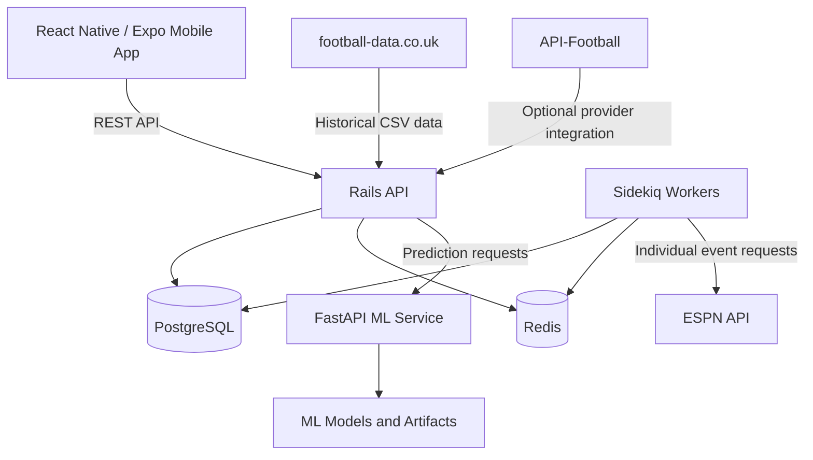

# ⚽ Sports Betting AI

### An evidence-driven football analytics and prediction platform

<p align="center">
  <strong>Collect. Analyze. Predict. Evaluate.</strong>
</p>

<p align="center">
  A full-stack football analytics platform combining historical match data, automated fixture and result synchronization, machine learning predictions, and prospective model evaluation.
</p>

<p align="center">
  <a href="https://github.com/kimathi72/sports_betting_ai">GitHub Repository</a> ·
  <a href="#architecture">Architecture</a> ·
  <a href="#getting-started">Getting Started</a> ·
  <a href="#roadmap">Roadmap</a>
</p>

---

## 🚧 Project Status

**Active development — experimental football analytics and machine learning project.**

This project investigates whether machine learning can produce useful, statistically reliable football match predictions.

| Component | Status |
|---|---|
| Docker infrastructure | Operational |
| Rails API | Operational |
| FastAPI ML service | Operational |
| Historical data imports | Implemented |
| ESPN fixture synchronization | Operational |
| Individual ESPN result checking | Operational |
| Automated result dispatcher | Activated in isolated mode |
| Prediction generation | Operational |
| Prospective evaluation infrastructure | Implemented |
| Independent statistical validation | Incomplete |
| Timestamp-valid live odds ingestion | Not implemented |
| Real-money betting readiness | Not established |

> **Important:** The system is experimental. It has not established sufficient statistical evidence to support real-money betting decisions.

---

## 📑 Table of Contents

- [Overview](#overview)
- [Why This Project Exists](#why-this-project-exists)
- [Core Objectives](#core-objectives)
- [Features](#features)
- [Supported Markets](#supported-markets)
- [Architecture](#architecture)
- [Technology Stack](#technology-stack)
- [Data Sources](#data-sources)
- [Machine Learning Approach](#machine-learning-approach)
- [Prediction Evaluation](#prediction-evaluation)
- [Getting Started](#getting-started)
- [Environment Configuration](#environment-configuration)
- [Development Workflow](#development-workflow)
- [Testing](#testing)
- [Automated Result Synchronization](#automated-result-synchronization)
- [Project Structure](#project-structure)
- [Development Principles](#development-principles)
- [Current Limitations](#current-limitations)
- [Roadmap](#roadmap)
- [Contributing](#contributing)
- [Disclaimer](#disclaimer)
- [License](#license)

---

## Overview

Sports Betting AI is a football analytics platform designed to investigate whether machine learning can produce statistically reliable football match predictions.

Rather than relying on manually selected betting tips, the platform is built around a complete data lifecycle:

1. Collect historical football data.
2. Normalize provider data into a consistent database.
3. Synchronize upcoming fixtures.
4. Generate predictions using machine learning.
5. Capture predictions before kickoff with model provenance.
6. Automatically retrieve actual match results.
7. Evaluate predictions against settled outcomes.
8. Compare performance against statistical baselines.
9. Investigate probability calibration and potential betting value.

The project combines backend engineering, machine learning, data engineering, mobile development, and automated testing into an integrated system.

## Why This Project Exists

Football prediction is a probabilistic problem.

A model can correctly predict several matches in succession and still be statistically unreliable. Likewise, high prediction accuracy does not automatically translate into profitable betting.

Many prediction systems overlook important questions:

- Were predictions generated before kickoff?
- Was the correct model version used?
- Were historical features available at prediction time?
- Are predicted probabilities calibrated?
- How does the model compare against simple baselines?
- Are bookmaker margins accounted for?
- Would predictions have produced positive expected value?
- Would a strategy survive realistic odds, losses, and drawdowns?

This project investigates these questions through disciplined engineering and empirical evaluation.

**The central principle: A prediction is a hypothesis. Its value must be established through evidence.**

## Core Objectives

### Engineering

- Build a maintainable football data ingestion system.
- Establish consistent team, competition, season, and match identities.
- Integrate Rails with a dedicated Python ML service.
- Automate fixture synchronization and result retrieval.
- Provide a mobile interface for exploring fixtures and predictions.
- Maintain reproducible development environments.
- Build comprehensive automated tests.

### Machine Learning

- Develop supervised models for football outcome prediction.
- Explore useful historical features and statistical approaches.
- Compare models against simple baselines.
- Evaluate probability quality rather than accuracy alone.
- Establish reliable prospective prediction tracking.
- Investigate whether predictions have measurable betting value.

### Long-term objective

Build a complete, independently validated football analytics platform capable of determining whether its predictions demonstrate measurable statistical value.

The goal is not to guarantee winning bets.

---

## Features

### Football Data Management

- Historical football match imports.
- Competition, season, team, and match records.
- External provider identity mapping.
- Canonical match reconciliation.
- Fixture and result synchronization.
- Duplicate detection and mapping validation.

### Prediction Engine

- Rails-to-FastAPI integration.
- Machine learning prediction service.
- Market-specific predictions.
- Model artifact provenance.
- Prediction capture with kickoff timestamps.
- Model freeze digest tracking.

### Automated Synchronization

- ESPN fixture discovery and synchronization.
- Individual ESPN event result retrieval.
- Scheduled result-check dispatching.
- Retry handling for unresolved results.
- Safe result reconciliation.
- SyncRun execution ledger.
- PostgreSQL advisory-lock protection.

### Mobile Application

- Competition browsing.
- Fixture listings.
- Completed match results.
- Match detail screens.
- Prediction generation interface.
- React Native and Expo navigation.

### Reliability and Testing

- Docker-based development infrastructure.
- Rails API health and readiness endpoints.
- Automated backend tests.
- Python ML tests.
- Mobile Jest tests.
- TypeScript checks.
- Expo Android export verification.

---

## Supported Markets

The prediction service currently supports five market categories.

| Market | Description |
|---|---|
| 1X2 | Home win, draw, or away win |
| Over/Under 2.5 | Whether total match goals exceed 2.5 |
| BTTS | Whether both teams score |
| Double Chance | Combined 1X2 outcomes |
| Correct Score | Predicted scoreline probabilities |

### 1X2

Three mutually exclusive outcomes:

- Home win
- Draw
- Away win

Their probabilities should sum to approximately 1.

### Over/Under 2.5

- Over 2.5 goals
- Under 2.5 goals

### Both Teams to Score

- BTTS Yes
- BTTS No

### Double Chance

Double Chance is derived from 1X2 probabilities.

| Market | Calculation |
|---|---|
| 1X | Home win + Draw |
| X2 | Draw + Away win |
| 12 | Home win + Away win |

**Important:** Double Chance outcomes overlap. Their probabilities are not mutually exclusive and sum to 2, not 1.

### Correct Score

The model produces a goal-distribution-based score prediction.

The current API returns a limited selection of the highest-ranked scorelines. Evaluation must account for omitted probability mass and recognize that displayed scorelines are only a subset of the complete distribution.

---

## Architecture

The project follows a service-oriented architecture using Docker Compose.



### Service Responsibilities

| Service | Responsibility |
|---|---|
| Rails API | Business logic, REST endpoints, data persistence, prediction orchestration |
| PostgreSQL | Canonical football records, predictions, synchronization and evaluation data |
| Redis | Background-job coordination and Sidekiq infrastructure |
| Sidekiq | Background synchronization and individual result-check jobs |
| FastAPI | Python ML inference and model-related functionality |
| React Native / Expo | Mobile application |
| External providers | Historical data, fixtures, and match results |

### Architectural Decisions

**Rails remains the backend gateway.**

The mobile application communicates with Rails. It does not communicate directly with FastAPI or external football providers.

**PostgreSQL is the canonical data store.**

External providers may use different team names, competition identifiers, season formats, and match identifiers. Provider data is reconciled against canonical records rather than creating independent representations.

**External provider IDs are not canonical identities.**

A provider identifier is a mapping, not the identity of a football match.

**Background synchronization is isolated.**

Result checking is separated from prediction generation and other scheduled jobs.

---

## Technology Stack

| Layer | Technology |
|---|---|
| Backend | Ruby on Rails |
| Language | Ruby |
| Database | PostgreSQL |
| Background processing | Sidekiq |
| Job coordination | Redis |
| Machine learning API | Python / FastAPI |
| Mobile | React Native |
| Mobile framework | Expo |
| Navigation | Expo Router |
| Backend testing | RSpec |
| Python testing | pytest |
| Mobile testing | Jest |
| Type checking | TypeScript |
| Infrastructure | Docker / Docker Compose |
| Version control | Git / GitHub |

---

## Data Sources

The platform is designed to use multiple football data sources.

### football-data.co.uk

Used primarily for historical football data and CSV imports.

Historical datasets may include:

- Match results.
- Team statistics.
- Historical bookmaker odds for supported leagues and markets.

Historical odds availability does not imply that timestamp-valid live odds are available.

### ESPN

Used for fixture discovery and individual match result checking.

Current documented competition mappings include:

| Competition | ESPN slug |
|---|---|
| Premier League | `eng.1` |
| Championship | `eng.2` |
| La Liga | `esp.1` |
| Bundesliga | `ger.1` |
| Serie A | `ita.1` |
| Ligue 1 | `fra.1` |
| Champions League | `uefa.champions` |

Additional competition mappings are maintained in:

`docs/espn_multi_competition_mapping.md`

ESPN coverage must not be assumed exhaustive. Provider responses may omit fixtures, change event status, or represent postponed events unexpectedly.

### API-Football

An optional provider integration.

Its free tier has request limits. Provider limits and available endpoints should be verified before expanding integration.

API credentials must remain in environment configuration and must never be committed to Git.

---

## Machine Learning Approach

The project initially explored both supervised and unsupervised learning.

### Supervised Learning

Supervised learning is the primary approach for football outcome prediction.

The model learns relationships between historical match features and known outcomes.

Potential features include:

- Recent team performance.
- Historical results.
- Home and away performance.
- Goal statistics.
- League characteristics.
- Elo ratings.
- Team strength estimates.

The feature pipeline must avoid using information that was unavailable at prediction time.

### Unsupervised Learning

Unsupervised learning may support:

- Team clustering.
- Performance grouping.
- Feature exploration.
- Anomaly detection.
- Similarity analysis.

It is not a substitute for supervised outcome evaluation.

### Model Evaluation

Models should be evaluated using:

- Brier score.
- Log loss.
- Calibration curves.
- Confidence intervals.
- Baseline comparisons.
- Per-market performance.
- Prospective prediction outcomes.

Accuracy alone is insufficient.

---

## Prediction Evaluation

The project deliberately separates three levels of readiness.

| Level | Meaning |
|---|---|
| Technical operation | The system can generate and store predictions |
| Statistical validation | Predictions demonstrate reliable performance on appropriate data |
| Betting readiness | Predictions demonstrate value after accounting for odds, costs, and risk |

The system has demonstrated technical operation.

Statistical validation remains incomplete.

Betting readiness has not been established.

### Historical Evaluation Split

The documented historical split is:

| Dataset | Date range | Records |
|---|---|---:|
| Training | Through December 3, 2023 | 28,364 |
| Validation | Through February 26, 2025 | 5,006 |
| Exploratory / spent | From February 27, 2025 onward | 5,889 |
| Untouched future holdout | Not yet available | 0 |

The exploratory dataset is not a clean holdout and must not be reused to claim independent validation.

### Prospective Evaluation

The system has infrastructure for capturing predictions before kickoff.

Captured predictions include:

- Match kickoff timestamp.
- Model freeze digest.
- Feature version.
- Prediction provenance.

Historical predictions without required provenance remain ineligible for prospective evaluation.

At the November 5, 2026 audit:

- 222 predictions existed.
- 155 had model digest and feature-version provenance.
- 67 legacy predictions were permanently ineligible.
- 0 prospective evaluation records had been settled.

These are historical project snapshots, not live performance claims.

### Calibration

Calibration infrastructure exists, but no real-data calibrator has been fitted and published.

Synthetic calibration tests establish software behavior, not model quality.

### Betting Evaluation

The following remain necessary:

- Timestamp-valid odds capture.
- Bookmaker margin removal.
- Expected-value calculations.
- Closing-line value analysis.
- Profit and return evaluation.
- Drawdown analysis.
- Per-market validation.
- Adequate prospective settlement volume.

### Correct Score and Double Chance

Correct Score requires evaluation of the full goal distribution, not only the displayed top six scorelines.

Double Chance requires special handling because its outcomes overlap.

### Evidence Threshold

The project has previously discussed an initial promotion target of approximately 1,000 eligible settled predictions.

This is a proposed engineering milestone, not a universal statistical standard. Market coverage, uncertainty, baseline performance, and pre-registered evaluation criteria must determine whether evidence is sufficient.

**Until adequate evidence exists, the system must return:**

`INSUFFICIENT EVIDENCE — NO BETTING RECOMMENDATION.`

---

## Getting Started

### Prerequisites

Install:

- Git.
- Docker.
- Docker Compose.
- WSL Ubuntu or another supported Linux environment.
- Node.js for local mobile development, if not using the Docker mobile service.

The project was developed primarily using WSL Ubuntu and Docker Compose.

### 1. Clone the Repository

```bash
git clone git@github.com:kimathi72/sports_betting_ai.git
cd sports_betting_ai
```

HTTPS alternative:

```bash
git clone https://github.com/kimathi72/sports_betting_ai.git
cd sports_betting_ai
```

### 2. Configure Environment Variables

Inspect the existing environment example files:

```bash
find . -maxdepth 3 \
  -type f \
  \( -name ".env.example" -o -name "*.env.example" \)
```

Create the required environment files using the repository's existing configuration.

Do not commit credentials or API keys.

### 3. Validate Docker Compose

```bash
docker compose config --quiet
```

### 4. Build and Start Services

```bash
docker compose up -d --build
```

Check service status:

```bash
docker compose ps
```

Inspect logs:

```bash
docker compose logs --tail=100 web ml postgres redis
```

**Note:** Do not start Sidekiq casually. Its cron mode controls scheduled synchronization jobs. Follow the isolated worker configuration documented below.

### 5. Verify Backend Health

```bash
curl -i http://localhost:3000/api/v1/health
```

Expected response:

```json
{
  "status": "ok"
}
```

### 6. Verify Backend Readiness

```bash
curl -i http://localhost:3000/api/v1/ready
```

Expected response when dependencies are available:

```json
{
  "status": "ready",
  "checks": {
    "database": "ok"
  }
}
```

Readiness should fail when the database is unavailable.

### 7. Verify the ML Service

```bash
docker compose ps ml
```

Inspect its health endpoint using the endpoint configured in the current ML service.

---

## Environment Configuration

The exact environment variables are defined by the current application configuration.

Typical configuration categories include:

| Category | Purpose |
|---|---|
| Rails | Application environment and secrets |
| PostgreSQL | Database connection |
| Redis | Background-job infrastructure |
| ESPN | Provider configuration |
| API-Football | Optional provider credentials |
| ML service | Internal service URL |
| Expo | Mobile API base URL |

### Security Rules

- Never commit `.env` files.
- Never expose API keys in logs or README examples.
- Never place provider credentials in mobile application source.
- Use Rails as the mobile application's backend gateway.
- Keep sensitive model artifacts and private datasets out of public repositories unless explicitly intended.

---

## Development Workflow

### Strict Test-Driven Development

The project follows a test-first workflow.

For each feature:

1. Identify the required behavior.
2. Write failing tests.
3. Implement the smallest suitable change.
4. Run focused tests.
5. Run relevant regression tests.
6. Inspect the final diff.
7. Update documentation.

Tests should validate intended behavior, not merely implementation details.

### Feature Development

- One scoped feature at a time.
- Single-purpose service methods.
- Reusable components.
- Minimal unrelated refactoring.
- Explicit data contracts.
- Regression coverage for existing functionality.

### Coding Agent

CodeGPT is the preferred coding agent for this repository.

Coding agents must preserve existing architecture, database state, Git history, and uncommitted changes.

---

## Testing

The project uses multiple testing layers.

### Rails

```bash
docker compose exec -T web bundle exec rspec
```

### Python ML Service

```bash
docker compose exec -T ml pytest
```

### Mobile Jest

```bash
cd mobile
npm test
```

### TypeScript

```bash
cd mobile
npx tsc --noEmit
```

### Expo Export

Use the existing Expo export script or configured command in the mobile package.

### Important Testing Hazard

The Sidekiq cron test suite contains an `after(:suite)` hook that removes Redis cron entries.

**Do not assume cron registration survives a full test-suite run.**

If the isolated result dispatcher is active, verify Redis cron registration afterward and restart the worker only if necessary and authorized.

---

## Automated Result Synchronization

The project uses ESPN to retrieve fixture and result updates.

The synchronization system is designed to avoid unnecessary provider requests and protect trusted historical records.

### Fixture Synchronization

Fixture synchronization:

- Resolves provider identities.
- Reconciles matches against canonical records.
- Prevents duplicate provider mappings.
- Preserves trusted completed results.
- Records synchronization activity.

### Individual Result Checking

The result-checking pipeline retrieves one ESPN event per individual match check.

It does not fetch the entire league scoreboard for each match.

The system handles:

- Completed matches.
- In-progress matches.
- Suspended matches.
- Postponed matches.
- Abandoned matches.
- Unresolved provider responses.

### Retry Policy

The individual result-checking job:

- Retries unresolved or transient failures.
- Uses a 30-minute retry interval.
- Operates within a bounded 24-hour post-kickoff window.
- Does not create new fixtures.
- Does not generate predictions.
- Does not overwrite trusted completed results.

### Dispatcher

`MatchResultDispatchJob` selects eligible matches from the database.

It does not call ESPN itself.

The dispatcher:

- Requires approved ESPN event mappings.
- Uses a bounded batch size.
- Avoids duplicate job dispatch.
- Records execution statistics.
- Enqueues individual match-check jobs.

### Isolated Cron Mode

The result dispatcher uses:

```bash
SIDEKIQ_CRON_MODE=result_dispatch_only
```

This mode registers only:

`MatchResultDispatchJob`

The other scheduled jobs remain disabled:

- Fixture synchronization.
- General result synchronization.
- ESPN discovery.
- API-Football live synchronization.

The default cron mode remains disabled unless explicitly configured.

---

## Project Structure

```text
sports_betting_ai/
├── backend/
│   ├── app/
│   │   ├── controllers/
│   │   ├── models/
│   │   ├── jobs/
│   │   └── services/
│   ├── config/
│   ├── db/
│   └── spec/
│
├── ml/
│   ├── app/
│   ├── artifacts/
│   └── tests/
│
├── mobile/
│   ├── app/
│   ├── src/
│   └── __tests__/
│
├── data/
│   └── fixtures/
│
├── docs/
│
├── docker-compose.yml
├── handout.md
└── README.md
```

### Important Documentation

| Document | Purpose |
|---|---|
| `handout.md` | Chronological project history and development handover |
| `docs/espn_multi_competition_mapping.md` | ESPN competition mapping |
| `docs/` | Architecture, implementation notes, and project documentation |

---

## Development Principles

1. **Data integrity comes first.** Provider inconsistencies must never silently corrupt canonical match records.
2. **Reproducibility matters.** Predictions must preserve enough provenance to establish which model and features produced them.
3. **Statistical honesty.** A working prediction endpoint is not evidence of predictive skill.
4. **Fail safely.** Unresolved provider data, invalid mappings, stale jobs, and insufficient evidence should not trigger unsafe actions.
5. **Automation must be controlled.** Scheduled jobs must be isolated and explicitly activated.
6. **Preserve historical evidence.** Existing predictions and evaluation artifacts should not be deleted simply to make results look cleaner.
7. **TDD is mandatory.** Tests should be written before implementation and cover realistic integration behavior.
8. **Keep the mobile architecture simple.** The mobile application communicates with Rails. ML and provider integrations remain behind the backend.

---

## Current Limitations

The project is actively evolving.

Current limitations include:

- Incomplete independent model validation.
- No untouched future holdout evaluation.
- No published real-data calibration model.
- No timestamp-valid live odds capture.
- No established expected-value evidence.
- No closing-line value evidence.
- No demonstrated long-term betting profitability.
- Correct Score probability coverage requires further validation.
- Double Chance requires specialized evaluation.
- ESPN fixture coverage is not guaranteed to be exhaustive.
- Android device testing has not been completed because the development environment lacks an Android SDK/emulator.

These limitations are documented intentionally. They define the next engineering and research milestones.

---

## Roadmap

### Phase 1 — Infrastructure

- [x] Docker-based development environment.
- [x] Rails API health endpoint.
- [x] Rails API readiness endpoint.
- [x] PostgreSQL and Redis integration.
- [x] FastAPI ML service.
- [x] Mobile application infrastructure.

### Phase 2 — Core Football Data

- [x] Competition, season, team, and match models.
- [x] External provider identity mappings.
- [x] Canonical match reconciliation.
- [x] Read-only football data API.
- [x] Historical import infrastructure.

### Phase 3 — Prediction Integration

- [x] Rails-to-FastAPI integration.
- [x] 1X2 prediction support.
- [x] Over/Under 2.5 prediction support.
- [x] BTTS prediction support.
- [x] Double Chance derivation.
- [x] Correct Score support.

### Phase 4 — Fixture Synchronization

- [x] ESPN competition mapping.
- [x] Fixture synchronization.
- [x] Provider identity reconciliation.
- [x] Duplicate mapping protection.
- [x] Safe result handling.

### Phase 5 — Prospective Evaluation

- [x] Prediction provenance.
- [x] Model freeze digest.
- [x] Kickoff timestamp capture.
- [x] Prospective evaluation infrastructure.
- [ ] Eligible prospective settlement.
- [ ] Independent holdout evaluation.
- [ ] Real-data calibration.
- [ ] Per-market statistical validation.

### Phase 6 — Automated Result Checking

- [x] Individual ESPN event retrieval.
- [x] Safe result reconciliation.
- [x] Retry handling.
- [x] Dispatcher job.
- [x] Duplicate dispatch protection.
- [x] Advisory-lock lifecycle handling.
- [x] Isolated cron mode.
- [x] Live dispatcher execution.
- [x] Automated result application.
- [ ] Multi-day stability monitoring.
- [ ] Long-term synchronization reliability report.

### Phase 7 — Odds and Betting Evaluation

- [ ] Timestamp-valid odds provider.
- [ ] Historical odds normalization.
- [ ] Bookmaker margin removal.
- [ ] Expected-value calculations.
- [ ] Closing-line value tracking.
- [ ] Prospective paper betting.
- [ ] Risk and drawdown analysis.
- [ ] Statistical promotion criteria.

### Phase 8 — Mobile and Product Refinement

- [x] Competition browsing.
- [x] Fixture ordering.
- [x] Completed match detail screen.
- [x] Prediction interface.
- [ ] Android device testing.
- [ ] Mobile UI refinement.
- [ ] Performance and usability improvements.

---

## Contributing

Contributions, suggestions, and technical discussions are welcome.

Before contributing:

1. Review the architecture and existing implementation.
2. Check the current roadmap and project handover.
3. Avoid duplicating completed functionality.
4. Write tests before implementation.
5. Preserve existing database and Git history.
6. Keep changes scoped and reviewable.
7. Document meaningful architectural decisions.
8. Never commit secrets, credentials, or private data.

### Suggested Contribution Areas

- Football data provider integrations.
- Data reconciliation improvements.
- Machine learning feature engineering.
- Model evaluation methodology.
- Statistical calibration.
- Mobile UI improvements.
- Automated testing.
- Documentation and architecture diagrams.

---

## Disclaimer

This project is developed for educational, research, and football analytics purposes.

Football predictions are inherently uncertain. Historical performance does not guarantee future results.

The software is not financial advice, betting advice, or a guarantee of profitability.

**The current system has not demonstrated sufficient statistical evidence to justify real-money betting.**

Any future betting-related functionality must be supported by independent validation, realistic odds evaluation, and appropriate risk controls.

---

## License

Review the repository's existing license before using, modifying, or distributing this project.

If no license has been established, all rights remain reserved by the copyright holder by default.

---

<p align="center">
  <strong>Built with curiosity, engineering discipline, and a commitment to evidence.</strong>
</p>

<p align="center">
  <em>Predict responsibly. Validate relentlessly.</em>
</p>
